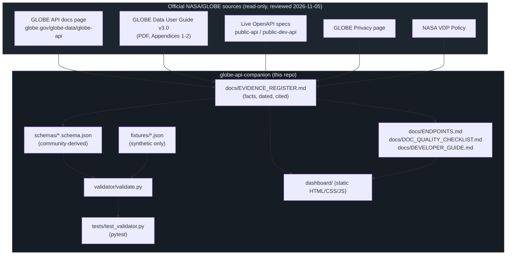

# Architecture

This project is entirely static/local: a documentation set, a dashboard that runs by
opening an HTML file (no server, no build step), and a Python validator exercised by a
local test suite. It never calls the live GLOBE API.

## Design choices

- **No network calls anywhere in the shipped code.** The dashboard is static HTML; the
  validator reads only local JSON files. This keeps the project safe to run and safe to
  hand to anyone, with zero risk of it accidentally hitting NASA systems.
- **Schemas are explicitly labeled community-derived**, with an `x-documentation-gap`
  field on every schema file, so nobody mistakes them for an official contract.
- **Evidence register is the single source of truth.** Every claim in the dashboard, the
  developer guide, and the doc-quality checklist traces back to a dated, cited row in
  `docs/EVIDENCE_REGISTER.md`.
- **Tests only touch fixtures**, never the network, so the suite is deterministic and
  safe to run in CI without secrets or external access.
